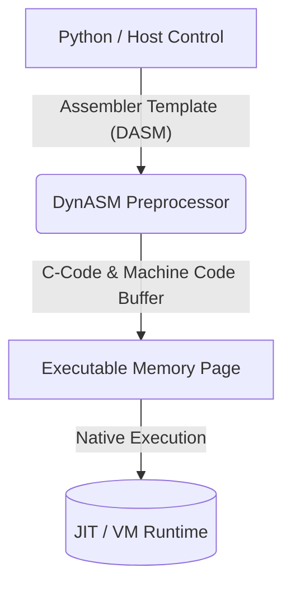

Hier ist die komplette, bereinigte `README.md` für das **Dynasm-Interface**, basierend auf den ersten Fundamenten und sauber formatiert für GitHub:

```markdown
# Dynasm Interface ⚙️

[]()
[](https://opensource.org/licenses/MIT)
[]()

> **Low-level dynamic code generation and native machine code emission.**  
> Das Dynasm-Interface schlägt die Brücke zwischen Hochsprachen-Logik und direkter Assembler-Generierung (x86_64 / AArch64) zur Laufzeit – optimiert für performante JIT-Execution und virtuelle Maschinen.

---

## 🏗️ Architektur & Funktionsweise

Das Interface nutzt DynASM-Makros, um Maschinencode direkt in alloziierte, ausführbare Speicherpuffer zu schreiben und zur Laufzeit auszuführen:



---

## 💡 Warum Dynasm?

* **Maximale Performance:** Direkte Ausführung von maschinennahem Code ohne Interpreter-Overhead.
* **Dynamische Code-Emissions:** Generierung von optimierten Funktionsblöcken zur Laufzeit (z. B. für JIT-Kompilierung oder Emulations-Beschleunigung).
* **Saubere Host-Integration:** Nahtlose Übergabe von Datenstrukturen und Funktionszeigern zwischen Host (Python/C) und generiertem Code.

---

## 🌟 Kernkonzepte

### 1. Dasm-Makro-Pipeline

Die `.dasm`-Dateien werden durch den Dynasm-Preprozessor geleitet, der daraus optimierten C-Quellcode mit eingebetteten Maschinen-Opcodes generiert.

### 2. Speicherverwaltung (Executable Memory)

Sicherer Umgang mit Speicherseiten (`mprotect` / `VirtualAlloc`), um generierte Puffer als ausführbar zu kennzeichnen.

### 3. Funktionszeiger-Binding

Konvertierung der rohen Speicheradresse in einen direkt aufrufbaren C-Funktionszeiger (`typedef` im Host-Code).

---

## ⚡ Schnellstart & Verwendung

### 1. Voraussetzungen

* Ein C-Compiler (GCC / Clang / MSVC)
* Lua (wird vom Dynasm-Preprozessor benötigt)
* Python 3.10+ (für die Steuerung und das Binding, falls angebunden)

### 2. Beispiel-Struktur einer Dynasm-Routine (`jit_engine.dasm`)

```c
|.arch x64
|.actionlist actions

void* generate_code(size_t *codesize) {
    dasm_State *dState;
    -| initialize_dasm(&dState, actions);

    // Beispiel: Einfache x86_64 Funktion (gibt z.B. 42 zurück)
    |.if x64
        | mov rax, 42
        | ret
    |.endif

    size_t sz;
    void *buf = link_and_encode_buffer(dState, &sz);
    *codesize = sz;
    
    dasm_free(dState);
    return buf;
}

```

---

## 🛠️ Mitwirken & Integration

Dieses Interface dient als High-Performance-Baustein für hardwarenahe Emulationen und Code-Generierungs-Pipelines. PRs zur Erweiterung um AArch64-Makros oder optimierte Speicher-Allocators sind jederzeit willkommen!

## 📄 Lizenz

Veröffentlicht unter der [MIT License](https://www.google.com/search?q=LICENSE).

```

<FollowUp label="Möchtest du, dass ich dir als nächsten Schritt den passenden C-Code für die Initialisierung des ausführbaren Dynasm-Speicherpuffers schreibe?" query="Erstelle mir den C-Code für die Initialisierung des ausführbaren Dynasm-Speicherpuffers."/>

```
